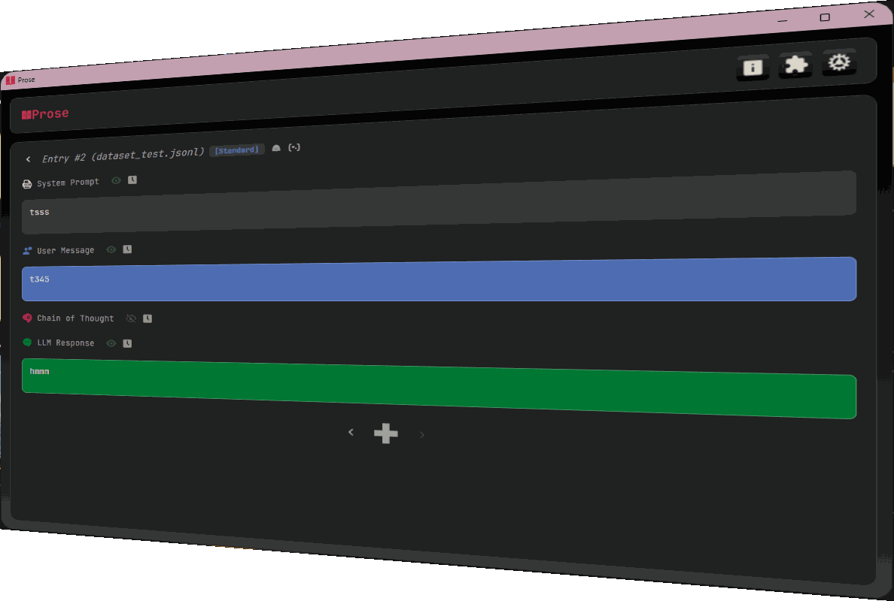
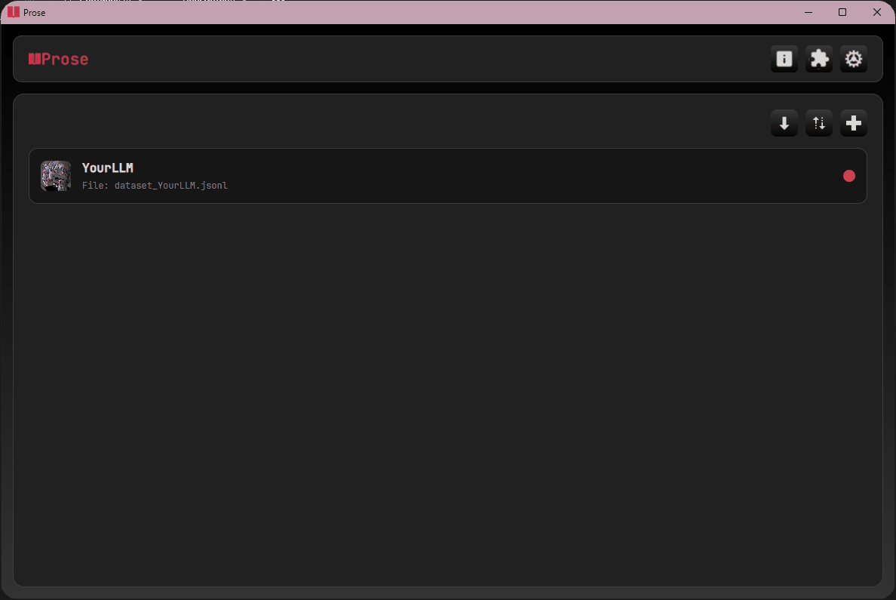
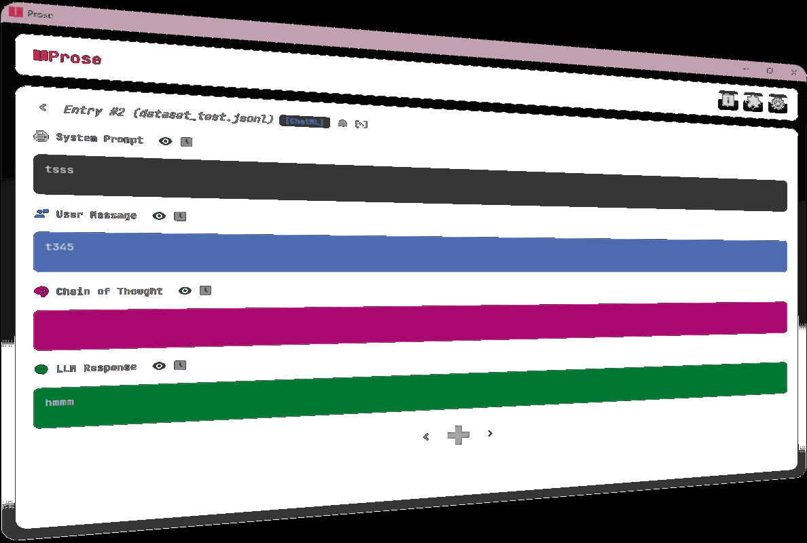
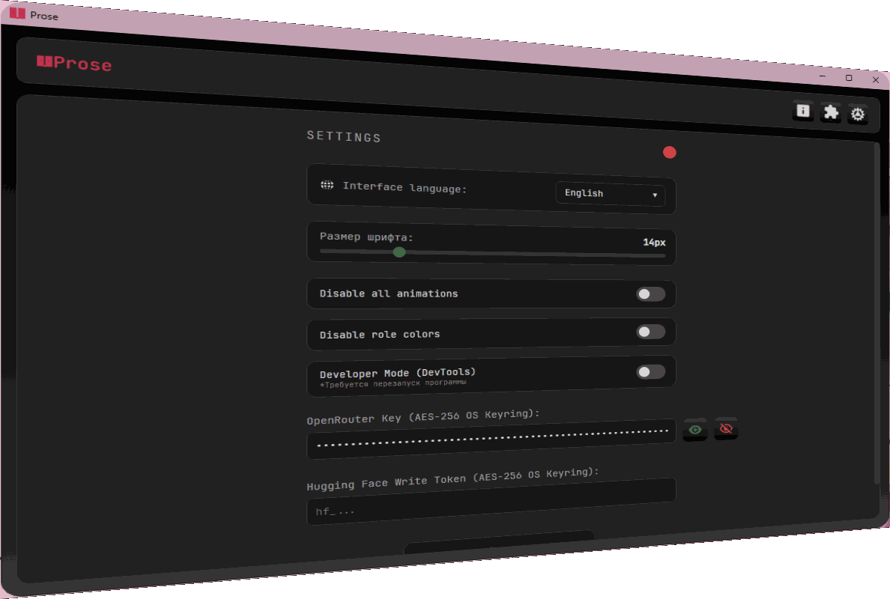

<div align="center">

  

  <h1 align="center" style="font-style: italic; color: #CB3153;">Prose</h1>

  <p align="center">
    <strong>A lightweight, ergonomic visual JSONL dataset editor for AI model fine-tuning and alignment</strong>
  </p>

  

  <br><br>

  <a href="https://github.com/Bodya3101/prose/releases/latest">
    
  </a>
  <a href="https://t.me/BodyaAckerman">
    
  </a>
  <a href="https://github.com/Bodya3101/prose">
    
  </a>

</div>

<br>

<!-- 3D GIF SHOWCASE TRIPTYCH -->
<div align="center">
  
  
  
</div>

<br>

###  Why I built Prose

I built Prose for myself because spending 2 hours debugging an unescaped quote or a missing comma at 3 AM is not my idea of a fun weekend :)

When you fine-tune LLMs, dataset preparation is usually a mess. Editing multi-gigabyte `.jsonl` files in VS Code or plain text editors leads to syntax errors that crash your 10-hour training run.

**Prose** turns raw, unreadable JSON lines into structured visual cards: System Prompt, User Query, Chain-of-Thought reasoning, and Assistant Response. No broken quotes, no syntax headaches, just clean data editing.

<br>

###  Supported Dataset Formats

Prose natively handles all major fine-tuning formats and lets you convert between them in a single click:

| Format | Native Support | Structure Example |
| :--- | :---: | :--- |
| **Standard JSONL** | ✅ | `{"system": "...", "user": "...", "assistant": "..."}` |
| **ChatML** | ✅ | `{"messages": [{"role": "user", "content": "..."}]}` |
| **ShareGPT** | ✅ | `{"conversations": [{"from": "human", "value": "..."}]}` |
| **Alpaca** | ✅ | `{"instruction": "...", "input": "...", "output": "..."}` |
| **Custom Schemas** | 🔌 Plugin | Extendable via 3-line Python plugin adapters |

<br>

###  Key Features

* **Ergonomic Card View**: Edit prompts and responses in distinct, color-coded blocks instead of wall-of-text JSON.
* **1-Click Format Conversion**: Convert entire dataset files on disk between ChatML, ShareGPT, Alpaca, and Standard format instantly.
* **AI Dataset Batch Generator**: Auto-generate dataset samples using OpenRouter API directly inside the editor.
* **O(1) Seek Performance**: Prose doesn't load whole multi-gigabyte files into RAM. It calculates byte-offset bookmarks, meaning jumping to entry #100,000 takes 0.001 seconds.
* **HuggingFace Integration**: Upload processed datasets directly to HuggingFace Hub in one click.
* **Zero Trust Security**: API keys are encrypted in OS Keyring, and file saves are atomic (written to `.tmp` first) so power outages never corrupt your work.

<br>

###  Prose as a Platform: Plugins & Extensibility

Prose was designed as an open foundation. It is not limited to text datasets: you can write custom Python plugins to turn Prose into an image dataset editor, audio dataset annotator, or integrate custom local AI backends like Ollama.

<div align="center">
  
</div>

<br>

#### Writing a custom format plugin in 5 minutes:
Every plugin lives in its own folder inside `/plugins/`. To support your own unique dataset schema, register a format adapter in your plugin's `backend/plugin.py`:

```python
def initialize_plugin(api_instance):
    def to_canonical(raw_json):
        return {
            "system": raw_json.get("sys_prompt", ""),
            "user": raw_json.get("query", ""),
            "thought": raw_json.get("reasoning", ""),
            "assistant": raw_json.get("completion", "")
        }

    def from_canonical(canonical):
        return {
            "sys_prompt": canonical.get("system", ""),
            "query": canonical.get("user", ""),
            "cot": canonical.get("thought", ""),
            "response": canonical.get("assistant", "")
        }

    api_instance.register_format_adapter(
        format_id="my_custom_schema",
        display_name="Custom Schema (query / cot / response)",
        to_canonical=to_canonical,
        from_canonical=from_canonical
    )
```

<br>

###  Installation

1. Download **`Prose_Setup.exe`** or the portable ZIP from the [Releases](https://github.com/Bodya3101/prose/releases) page.
2. Run the installer and follow the setup wizard.

#### Build from Source:
```bash
# Clone repository
git clone https://github.com/Bodya3101/prose.git
cd prose

# Install dependencies
pip install pywebview keyring requests huggingface_hub Pillow

# Run application
python backend/main.py
```

<br>

<!-- РУССКАЯ ВЕРСИЯ ВНУТРИ СПОЙЛЕРА -->
<details>
<summary><b><code>[ RU ] Перевод на русский язык</code></b></summary>
<br>

###  Зачем я создал Prose

Я написал Prose в первую очередь для себя. Потому что когда вы в 3 часа ночи вылавливаете пропущенную кавычку или незаэкранированный слэш в файле на 500 тысяч строк, желание заниматься ИИ резко отпадает :)

При дообучении и выравнивании моделей (LLM Alignment / Fine-Tuning) подготовка данных часто превращается в хаос. Обычные текстовые редакторы или VS Code не приспособлены для сырого JSONL: одна синтаксическая ошибка ломает ваш 10-часовой прогон обучения.

**Prose** решает эту проблему. Программа превращает нечитаемые строки формата JSONL в наглядные закругленные карточки: Системный промпт, Запрос пользователя, Ход размышлений (CoT) и Ответ модели. Без съехавших кавычек, без вылетов и с полной сохранностью данных.

<br>

###  Поддерживаемые форматы датасетов

Prose нативно поддерживает все ключевые схемы разметки и позволяет переключаться между ними в один клик:

| Формат | Поддержка | Пример структуры |
| :--- | :---: | :--- |
| **Standard JSONL** | Нативная | `{"system": "...", "user": "...", "assistant": "..."}` |
| **ChatML** | Нативная | `{"messages": [{"role": "user", "content": "..."}]}` |
| **ShareGPT** | Нативная | `{"conversations": [{"from": "human", "value": "..."}]}` |
| **Alpaca** | Нативная | `{"instruction": "...", "input": "...", "output": "..."}` |
| **Свои схемы** | Плагины | Подключаются адаптерами в 3 строчки Питона |

<br>

###  Ключевые возможности

* **Наглядный карточный редактор**: Редактирование промптов и ответов в сдержанных закругленных блоках вместо мешанины из JSON кода.
* **Конвертация форматов в 1 клик**: Изменяйте разметку датасета прямо на диске между ChatML, ShareGPT, Alpaca и Стандартным форматом.
* **ИИ-Генератор датасетов**: Автоматическое расширение и генерация пачек данных прямо из редактора через OpenRouter API.
* **Мгновенное чтение файлов O(1)**: Prose не загружает гигабайтные файлы целиком в оперативную память. Он расставляет байтовые закладки, поэтому переход на 100 000-ю запись занимает 0.001 секунды.
* **Интеграция с HuggingFace**: Выгрузка готовых наборов данных прямо в репозитории HF Datasets.
* **Строгая безопасность (Zero Trust)**: Ключи шифруются в реестре ОС через хранилище Keyring, а сохранение идет атомарно, так что отключение света не сотрет вашу работу.

<br>

###  Prose как база: Плагины и Расширяемость

Prose задумывался не просто как редактор текста, а как фундаментальный каркас для ваших собственных инструментов. Вы можете написать свой плагин на Python и превратить Prose в редактор датасетов изображений, разметку аудиотегов или подключить локальную нейросеть через Ollama.

<br>

###  Установка

1. Скачайте **`Prose_Setup.exe`** или портативный ZIP из раздела [Releases](https://github.com/Bodya3101/prose/releases).
2. Запустите установщик и следуйте простым шагам.

</details>

<br>

###  Tech Stack
<div align="left">
  <a href="https://skillicons.dev">
    
  </a>
</div>

<br>

###  Contact & Support

Prose is developed independently. If this tool saves you time, leaving a star ⭐️ on GitHub means a lot!

<br>

<div align="left">
  <a href="https://t.me/BodyaAckerman">
    
  </a>
  <a href="https://github.com/Bodya3101">
    
  </a>
</div>
